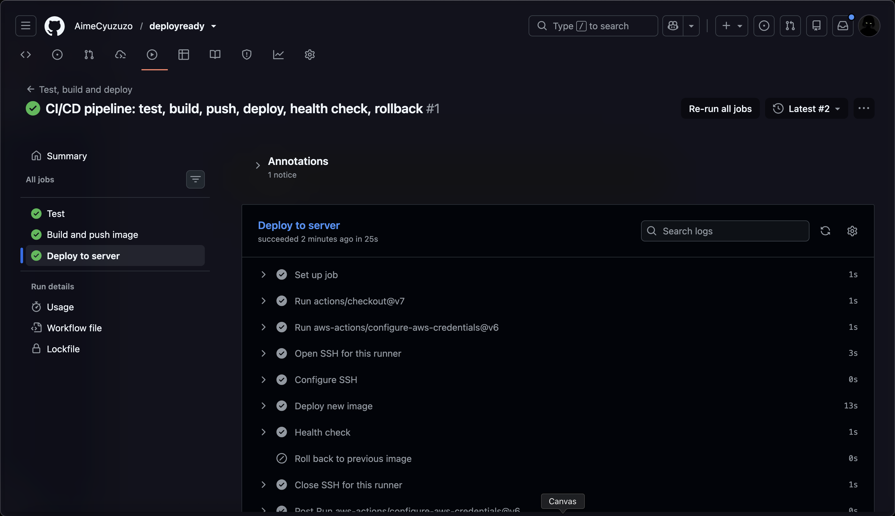
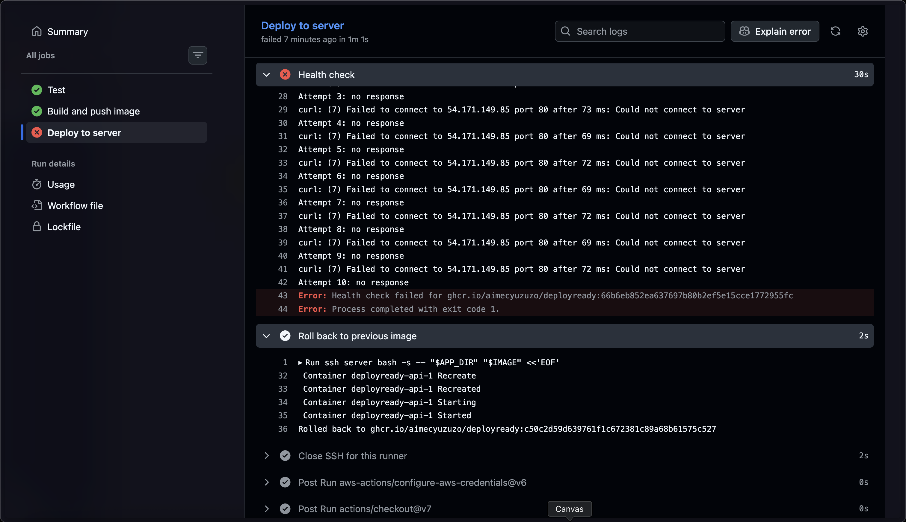
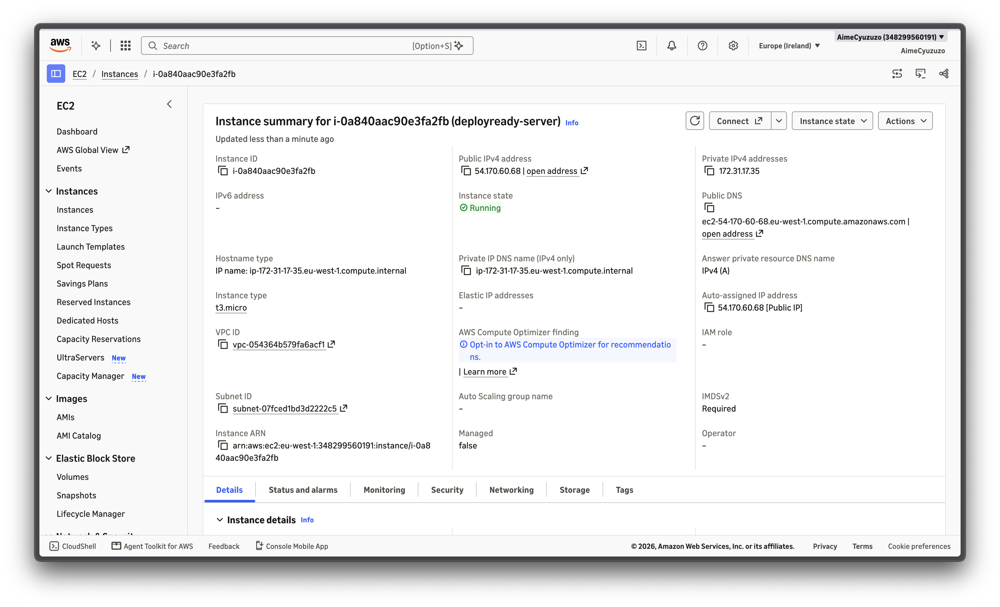
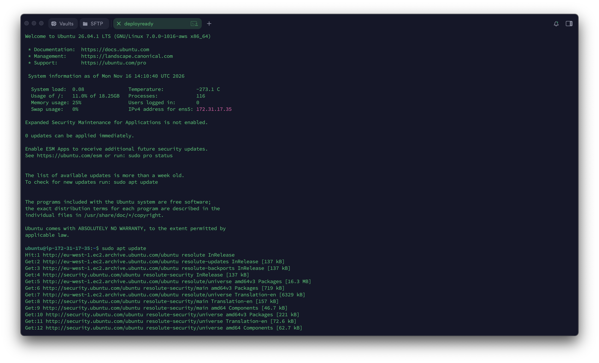
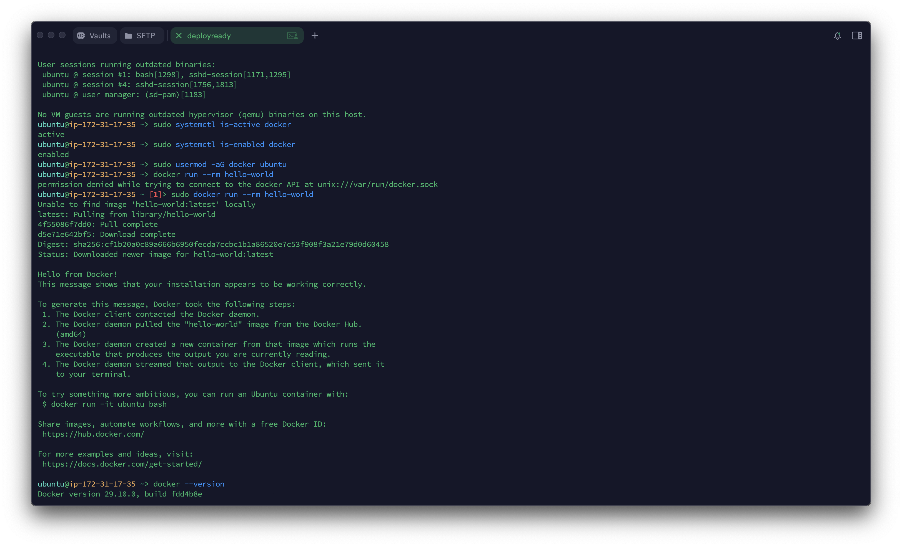
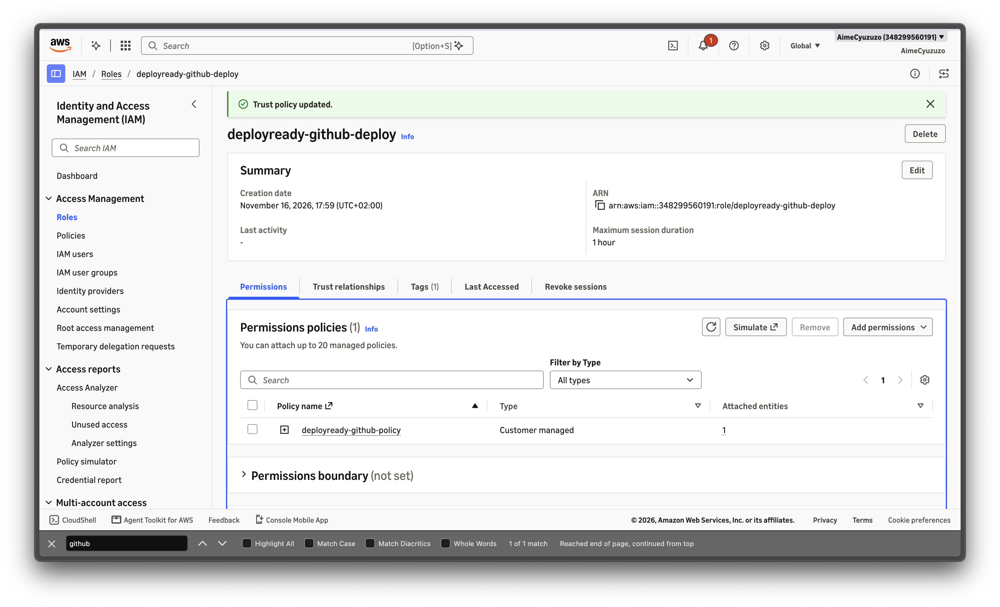
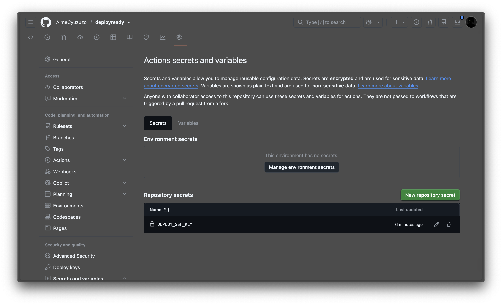
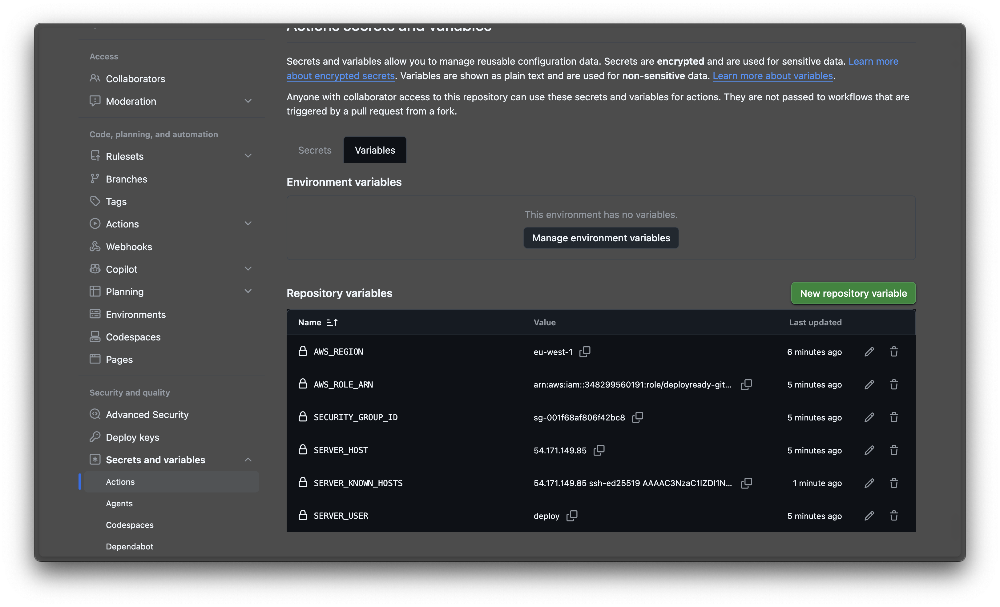

# Deployment

How the Kora Analytics API is deployed, run, monitored and rolled back.

**Live endpoint:** http://54.171.149.85/health → `{"status":"ok"}`

---

## 1. Deployment service

| | Choice |
|---|---|
| Cloud provider | **AWS** |
| Compute | **EC2** `t3.micro`, Ubuntu Server 26.04 LTS, 20 GiB gp3 disk |
| Region | **eu-west-1 (Ireland)** |
| Public address | **Elastic IP** `54.171.149.85` |
| Container registry | **GitHub Container Registry** (`ghcr.io/aimecyuzuzo/deployready`) |
| CI/CD | **GitHub Actions** (`.github/workflows/deploy.yml`) |

**Why AWS EC2**

- A single small VM is all this API needs; `t3.micro` is free-tier eligible and its burstable CPU suits low, spiky traffic.
- AWS IAM supports **GitHub OIDC**, so the pipeline gets short-lived credentials instead of stored access keys.
- Security groups can be changed through the API, which lets the pipeline open SSH for itself only during a deploy (see [Section 5.3](#53-how-the-runner-reaches-the-server-safely)).
- eu-west-1 is close to East Africa, supports every service used here, and is simpler and cheaper than af-south-1 (which must be opted into).

**Why GitHub Container Registry**

- The pipeline pushes with the workflow's automatic `GITHUB_TOKEN`, so no registry token has to be created, stored or rotated.

---

## 2. Architecture

See the [architecture diagram in the README](README.md#architecture).

---

## 3. How the virtual machine was set up

All infrastructure was created in the **AWS console**.

### 3.1 Account hygiene

- Root user protected with **MFA**; a separate IAM admin user (also with MFA) is used for day-to-day console and CLI work.
- An **AWS Budgets** alert emails me if spending starts.
- Every resource is tagged `Project = deployready` so it can be found, costed and cleaned up together.

### 3.2 Security group (firewall): `deployready`

| Direction | Port | Source | Purpose |
|---|---|---|---|
| Inbound | 80 (HTTP) | `0.0.0.0/0` | Public API traffic |
| Inbound | 22 (SSH) | **my IP only** (`/32`) | Admin access |
| Inbound | 22 (SSH) | GitHub runner IP `/32`, **temporary** | Added and removed by the pipeline during each deploy |
| Outbound | all | `0.0.0.0/0` | Pull images and OS updates |

SSH is **never** open to `0.0.0.0/0`. Security groups are stateful, so responses to allowed inbound requests (and replies to the server's own outbound requests) need no extra rules.

### 3.3 EC2 instance: `deployready-server`

- AMI: **Ubuntu Server 26.04 LTS** (x86_64), instance type **t3.micro**.
- Key pair: **ED25519**; the private key is kept only on my machine (`chmod 400`).
- Network: default VPC, attached to the `deployready` security group (not the launch wizard's default "SSH from anywhere" group).
- Storage: **20 GiB gp3**, leaving room for the current and previous images plus logs (within the free-tier 30 GiB).

### 3.4 Elastic IP

An Elastic IP (`54.171.149.85`) is associated with the instance so the address does not change when the instance is stopped and started. Reviewers, the pipeline and the docs all use this one address.

### 3.5 Users on the server

| User | Used by | Login | sudo | Docker |
|---|---|---|---|---|
| `ubuntu` | Me (admin) | My personal SSH key | Yes | Yes |
| `deploy` | GitHub Actions | Dedicated deploy key, no password | **No** | Yes |

The pipeline has its own user and key so its access can be revoked without affecting mine, and a leaked pipeline key does not give sudo.

```bash
sudo adduser --disabled-password "" deploy
sudo usermod -aG docker deploy
sudo mkdir -p /home/deploy/.ssh
sudo nano /home/deploy/.ssh/authorized_keys      # paste the deploy public key
sudo chown -R deploy:deploy /home/deploy/.ssh
sudo chmod 700 /home/deploy/.ssh
sudo chmod 600 /home/deploy/.ssh/authorized_keys
```

> Membership of the `docker` group is effectively root-equivalent. This is accepted because the deploy key exists only as a GitHub secret and SSH is closed to everyone but me except during deploys.

### 3.6 App directory

```bash
sudo mkdir -p /var/www/deployready
sudo chown deploy:deploy /var/www/deployready
```

Everything inside it is written by the pipeline; nothing is configured by hand:

| File | Purpose |
|---|---|
| `docker-compose.yml` | Copied from `deploy/docker-compose.prod.yml` on every deploy |
| `.env` | `IMAGE=<registry image:commit-sha>` and `PORT=3000` |
| `.previous_image` | The image that was live before the latest deploy (used for rollback) |

---

## 4. How Docker was installed and how the image is pulled

### 4.1 Docker installation (official Docker apt repository)

Commands are for the **fish** shell (fish 4.2 on the server).

```fish
sudo apt-get update; and sudo apt-get upgrade -y

# Docker's signing key
sudo apt-get install -y ca-certificates curl
sudo install -m 0755 -d /etc/apt/keyrings
sudo curl -fsSL https://download.docker.com/linux/ubuntu/gpg -o /etc/apt/keyrings/docker.asc
sudo chmod a+r /etc/apt/keyrings/docker.asc
gpg --show-keys /etc/apt/keyrings/docker.asc   # fingerprint 9DC8 5822 9FC7 DD38 854A E2D8 8D81 803C 0EBF CD88

# Docker's repository (deb822 format)
printf '%s\n' \
    'Types: deb' \
    'URIs: https://download.docker.com/linux/ubuntu' \
    'Suites: '(sed -n 's/^VERSION_CODENAME=//p' /etc/os-release) \
    'Components: stable' \
    'Architectures: '(dpkg --print-architecture) \
    'Signed-By: /etc/apt/keyrings/docker.asc' \
    | sudo tee /etc/apt/sources.list.d/docker.sources > /dev/null
sudo apt-get update

sudo apt-get install -y docker-ce docker-ce-cli containerd.io docker-buildx-plugin docker-compose-plugin

sudo systemctl is-active docker     # active
sudo systemctl is-enabled docker    # enabled (starts on boot)
sudo usermod -aG docker ubuntu      # then log out and back in
docker run --rm hello-world
```


### 4.2 How the image gets to the server

1. The pipeline builds the image **once** in CI and pushes it as `ghcr.io/aimecyuzuzo/deployready:<commit-sha>`.
2. During the deploy, the runner logs the server into `ghcr.io` with the run's temporary `GITHUB_TOKEN` (passed through stdin), then runs on the server:
   ```bash
   cd /var/www/deployready
   docker compose pull
   docker compose up -d --remove-orphans
   ```
3. The server is logged out of the registry straight afterwards, so no registry credentials are stored on it.

The exact image that passed the tests is the one that runs in production; nothing is built on the server.

---

## 5. CI/CD pipeline

File: `.github/workflows/deploy.yml`, run on every push to `main`.

| Job | Steps |
|---|---|
| **test** | Checkout → Node 22 → `npm ci` → `npm test`. A failure stops the pipeline. |
| **build** | Build the Dockerfile → push to `ghcr.io` tagged with the commit SHA (layer cache via the GitHub Actions cache). |
| **deploy** | Assume the AWS role via OIDC → open SSH for the runner IP → configure SSH → copy the compose file, write `.env`, pull and start the new image → health check → roll back on failure → always close SSH. |

Only one deploy runs at a time (`concurrency`), and a running deploy is never cancelled halfway.

### 5.1 Secrets and variables (GitHub → Settings → Secrets and variables → Actions)

| Type | Name | Contents |
|---|---|---|
| Secret | `DEPLOY_SSH_KEY` | Private key of the `deploy` user |
| Variable | `AWS_REGION` | `eu-west-1` |
| Variable | `AWS_ROLE_ARN` | ARN of the `deployready-github-deploy` IAM role |
| Variable | `SECURITY_GROUP_ID` | ID of the `deployready` security group |
| Variable | `SERVER_HOST` | `54.171.149.85` |
| Variable | `SERVER_USER` | `deploy` |
| Variable | `SERVER_KNOWN_HOSTS` | The server's pinned ED25519 host key |
| Variable | `APP_PORT` | `3000` |

Only the private key is sensitive. The registry token is the automatic `GITHUB_TOKEN`, and AWS access uses OIDC, so **no long-lived registry or AWS credentials exist anywhere**.

### 5.2 Pipeline identity in AWS (least privilege)

- **OIDC identity provider:** `token.actions.githubusercontent.com`, audience `sts.amazonaws.com`.
- **IAM role `deployready-github-deploy`:** its trust policy only accepts tokens whose subject is this repository's `main` branch, pinned with GitHub's immutable owner and repository IDs:
  ```json
  "StringEquals": {
    "token.actions.githubusercontent.com:aud": "sts.amazonaws.com",
    "token.actions.githubusercontent.com:sub": "repo:AimeCyuzuzo@89910012/deployready@1458870588:ref:refs/heads/main"
  }
  ```
- **Permissions:** exactly two actions on exactly one security group:
  ```json
  "Action": ["ec2:AuthorizeSecurityGroupIngress", "ec2:RevokeSecurityGroupIngress"],
  "Resource": "arn:aws:ec2:eu-west-1:<account-id>:security-group/<deployready-sg-id>"
  ```
  The role cannot launch instances, read data, or touch any other resource.

### 5.3 How the runner reaches the server safely

- GitHub-hosted runners use changing IPs, while SSH is restricted to my IP. The pipeline therefore adds a temporary `tcp/22` rule for **its own IP `/32`** (rule description `github-actions-run-<run id>`), deploys, and removes the rule in a step that runs **even if earlier steps fail**.
- The server's host key is **pinned** in `SERVER_KNOWN_HOSTS` and SSH runs with `StrictHostKeyChecking yes`, so the pipeline refuses to talk to an impostor instead of disabling host key checking.

---

## 6. Health check and rollback

After `docker compose up`, the runner calls `http://54.171.149.85/health` up to 10 times (3 s apart) and requires `"status":"ok"`.

If the deploy step or the health check fails:

1. The rollback step reads `.previous_image`, writes it back into `.env`, and runs `docker compose up -d`. The previous image is still on disk, so this takes seconds.
2. The workflow is still marked **failed**, so the broken release is visible and the committer is notified.

Safety checks: if the new image was never switched in, nothing is changed; on the very first deploy (no previous image) it only warns.

### Rollback test (performed)

| Commit | What | Result |
|---|---|---|
| `66b6eb8` | Deliberately changed the Dockerfile `CMD` to a file that does not exist, so the container crashes on start (app logic untouched) | Health check failed → rolled back to `c50c2d5` → run marked failed ✅; `/health` OK after rollback |
| `9304c25` | `git revert` of the broken commit | Green run; working image deployed ✅ |

---

## 7. Checking that the container is running

On the server (`ssh ubuntu@54.171.149.85`):

```bash
cd /var/www/deployready
docker compose ps            # STATUS should be "Up ... (healthy)"
cat .env                     # which image (commit SHA) is live
curl -s localhost/health     # {"status":"ok"}
```

From anywhere:

```bash
curl -i http://54.171.149.85/health
```

The image's Docker `HEALTHCHECK` calls `/health` every 30 s, so `docker compose ps` shows `healthy` or `unhealthy` by itself.

---

## 8. Viewing the application logs

Container stdout/stderr is captured by Docker's `json-file` driver with rotation (`max-size: 10m`, `max-file: 5`), so logs are kept for review without filling the disk.

```bash
cd /var/www/deployready
docker compose logs              # everything kept
docker compose logs -f           # follow live
docker compose logs --tail 100   # last 100 lines
docker compose logs --since 1h   # last hour
```

Deploy history and pipeline logs are in the repository's **Actions** tab.

---

## 9. Observability

| Signal | Where | What it tells me |
|---|---|---|
| Pipeline health check | GitHub Actions | Whether a new release actually works; triggers rollback |
| Docker `HEALTHCHECK` | `docker compose ps` | Whether the running container still answers `/health` |
| `restart: unless-stopped` | Docker | Crashed containers restart automatically, including after reboots |
| EC2 status checks | EC2 console | Whether the VM and the AWS hardware under it are healthy |
| `/metrics` | `http://54.171.149.85/metrics` | App uptime and memory usage |
| Container logs | `docker compose logs` | Startup output and crash errors |
| CloudTrail | AWS console | Every AWS API call, including the pipeline's SSH open/close and role assumptions |

**How I would spot…**

- **A failed deployment:** the run turns red in GitHub Actions (GitHub emails the committer). The *Health check* step shows the failing responses and *Roll back* shows which image was restored.

  A healthy release: every deploy step green, *Roll back* skipped.

  

  The deliberate broken release (`66b6eb8`): the health check gets no response on port 80 for 10 attempts, fails the run, and the rollback restores `c50c2d5`.

  

- **A crash:** `docker compose ps` shows `unhealthy` or `Restarting`; `/metrics` shows `uptime_seconds` reset to a small number; `docker compose logs` shows the error output.
- **Rising error rates:** the app does not log individual requests, and its logic must not be changed, so error rates are not measured yet. I would add request logging (or an nginx reverse proxy with access logs), ship logs to CloudWatch Logs, and create a metric filter and alarm on 5xx responses.

---

## 10. Troubleshooting notes (real issues hit during setup)

| Symptom | Cause | Fix |
|---|---|---|
| `Permission denied (publickey)` when logging in as `deploy` | `.ssh/` and `authorized_keys` were owned by `root`, so `deploy` could not read its own key list | `sudo chown -R deploy:deploy /home/deploy/.ssh` |
| `apt-get update` errors for the Docker repository after Docker was already installed | During setup, a bash-syntax command run in fish overwrote `/etc/apt/keyrings/docker.asc` with an HTML page from docker.com and added a malformed `docker.list`. Docker itself had already been installed from the verified repository. | Removed `docker.list`, re-downloaded the key from `download.docker.com/linux/ubuntu/gpg`, checked the fingerprint with `gpg --show-keys`, and confirmed a clean `apt-get update` |
| `Not authorized to perform sts:AssumeRoleWithWebIdentity` | (1) The OIDC audience was a regional STS endpoint instead of `sts.amazonaws.com`. (2) GitHub's token subject includes immutable IDs (`AimeCyuzuzo@89910012/deployready@1458870588`), which the trust policy did not match. | Found the real `aud` and `sub` in **CloudTrail → Event history**, then fixed the provider audience and the role's trust policy |

---

## 11. Known limitations and next steps

- **Brief downtime on deploy:** the old container is replaced before the new one is verified, so a bad release causes roughly 30–60 s of downtime before rollback. A blue-green or rolling deploy behind a reverse proxy or load balancer would remove this.
- **Single server:** no redundancy. Production would use several instances behind a load balancer and a DNS name.
- **Admin IP changes:** if my home IP changes, the SSH rule must be updated. SSM Session Manager would remove the need for port 22.
- **Logs live on the server:** shipping them to CloudWatch Logs would keep them if the instance is lost.
- **Old images accumulate:** a periodic `docker image prune` that keeps the current and previous image would bound disk use.

---

## 12. Cost and teardown

Approximate monthly cost, covered by AWS credits: EC2 `t3.micro` ~$7.50, public IPv4 / Elastic IP ~$3.60, 20 GiB gp3 ~$1.75.

To remove everything after review: terminate the instance (deletes the disk), **release the Elastic IP** (it is billed while unattached), then delete the security group, IAM role, policy, OIDC provider and the `ghcr.io` package. Everything carries the `Project = deployready` tag, so Resource Groups & Tag Editor can list it all.

---

## Screenshots

All screenshots are in [`docs/screenshots/`](docs/screenshots/).

**EC2 instance** (taken before the Elastic IP was attached, so it still shows the auto-assigned public IP)



**First SSH login** (Ubuntu 26.04.1 LTS)



**Docker installed:** service active and enabled, `hello-world` runs, version 29.10. The first `docker run` fails with *permission denied* because the new `docker` group membership only applies after logging in again.



**Pipeline IAM role** with its single customer-managed policy



**GitHub Actions secrets and variables**





**Pipeline runs:** see [Section 9: Observability](#9-observability) (successful run and rollback run).
